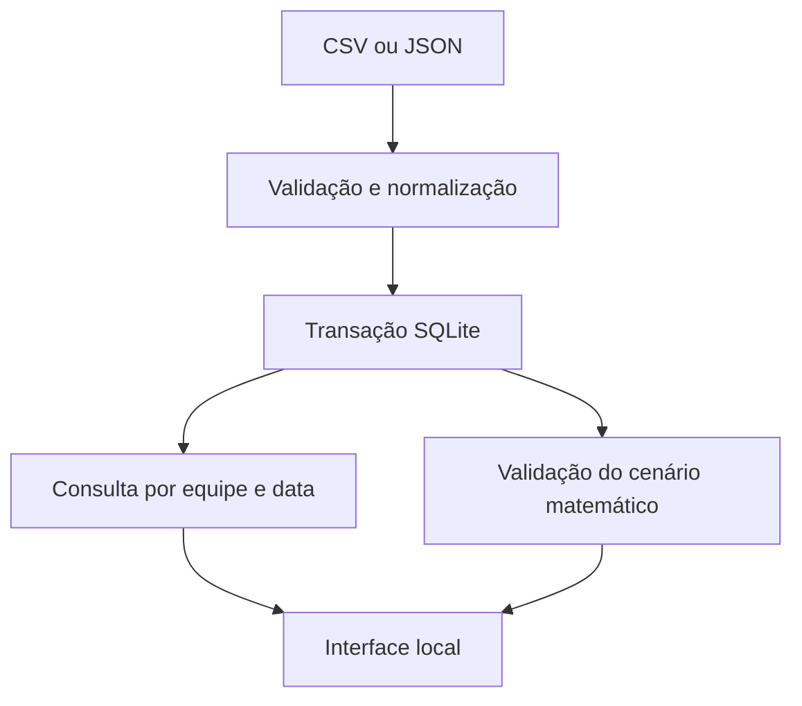

# Arquitetura

## Organização

| Caminho | Responsabilidade |
| --- | --- |
| `src/server.js` | Inicialização, exemplos sintéticos e encerramento do banco. |
| `src/app.js` | Rotas HTTP, configuração, importação e histórico. |
| `src/db.js` | Esquema, migração, consultas e transações SQLite. |
| `src/importer.js` | Leitura CSV e validação de cotações. |
| `src/footyCsv.js` | Partidas concluídas e janelas estatísticas. |
| `src/marketIntegrity.js` | Completude do mercado e validade temporal. |
| `src/calculations.js` | Arbitragem, EV, consenso sem margem e Kelly. |
| `src/betBuilder.js` | Liquidação histórica, frequência por seleção e relações entre seleções. |
| `src/oddsPapi.js`, `src/footyStats.js` | Adaptadores preservados, testados com respostas simuladas. |
| `public/` | Interface existente, com apresentação e ações offline. |
| `examples/` | Cotações e partidas sintéticas reproduzíveis. |
| `test/` | Regras de negócio, persistência, HTTP e regressão. |

## Fluxo de importação

Partidas incompletas não entram no histórico estatístico. A data de corte exclui partidas disputadas a partir do instante selecionado. Cada média informa o número de valores observados; a presença da partida não implica disponibilidade de todas as métricas.

## Limites de rede

O processo de produção sempre chama `createApp({ db })`, sem transporte externo habilitado. A aplicação detecta o transporte nativo e bloqueia as rotas de provedores e de busca de cotações antes de executá-las. A análise histórica também interrompe o caminho de obtenção de odds externas.

Os testes dos adaptadores injetam `fetchImpl` com respostas em memória. Isso preserva a verificação das integrações sem consultar contas reais. Não existe variável de ambiente para reativar provedores nesta edição.

`simulationOnly=false` e `enforceFreshness=false` aparecem em testes de regressão dos snapshots antigos para exercitar o comportamento anterior com dados fixos. O servidor da demonstração mantém ambos os controles habilitados. Alterar o código de inicialização ou injetar um transporte diferente exige nova revisão; esse desenho não pretende impedir modificações feitas por quem possui o código.

## Persistência

As tabelas separam mercados, cotações, configuração, histórico, partidas, agregados CSV e cenários. A cotação mais recente por mercado/resultado/fonte é selecionada com `ROW_NUMBER`. A importação e a liquidação usam transações.

A migração adiciona `expected_outcomes` sem recriar o banco. Mercados antigos cuja definição não pode ser inferida ficam sem cálculo até que recebam uma definição explícita. Não é seguro deduzir a completude apenas da quantidade de cotações recebidas.

## Próximos passos possíveis

- Separar os grupos de rotas conforme o projeto crescer.
- Fazer testes visuais em navegador e melhorar a acessibilidade com evidência de uso.
- Criar avaliações estatísticas fora da amostra antes de apresentar qualquer capacidade preditiva.
- Projetar autenticação, isolamento de usuários e limites de recursos antes de considerar hospedagem.

Esses itens não foram apresentados como funcionalidades já implementadas.
